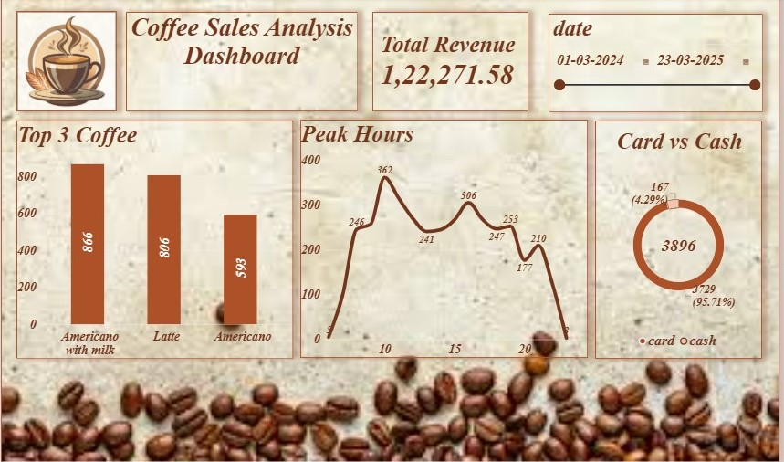

# ☕ Coffee Sales Data Analytics Project

## 📌 Executive Summary
An end-to-end data analytics project transforming raw, multi-file coffee sales CSV datasets into structured data models using Excel and PostgreSQL, culminating in an interactive Power BI dashboard to evaluate sales trends, peak store traffic hours, and payment preferences.

---

## 🖼️ Dashboard Preview

---

## 🛠️ Data Pipeline & Technical Architecture
1. **Raw Data Ingestion:**
   - Ingested two raw, uncleaned coffee sales CSV files (`Raw_Messy_Dataset1.csv`, `Raw_Messy_Dataset2.csv`).
2. **Data Cleaning & Transformation (Excel):**
   - Handled null values, formatted timestamps into standardized date formats, and merged dataset structures into `Cleaned_Coffee_Dataset.xlsx` and `Cleaned_Coffee_Dataset.csv`(both csv and xlsx file have same content).
3. **Exploratory Data Analysis (PostgreSQL / SQL):**
   - Wrote SQL queries (`Coffee_Sheet_Query.sql`) using `GROUP BY`, aggregation functions, and subqueries to calculate key business metrics (Total Revenue, top-selling coffee items, and transaction type breakdown).
4. **Data Visualization (Power BI):**
   - Built an interactive dashboard (`Coffee_Sales_Analysis_Dashboard.pbix`) featuring revenue KPI cards, bar charts for top products, time-series line charts for peak store hours, and payment method distribution.

---

## 💡 Key Business Insights
- **Total Revenue:** Generated ₹1,22,271.58 across the tracked sales period.
- **Top Revenue Driver:** "Americano with Milk" emerged as the highest-selling coffee variant (866 orders), followed closely by Latte (806 orders).
- **Peak Store Hours:** Customer order traffic spikes significantly around 10:00 AM (reaching 362 orders), highlighting prime hours for store staffing and promotional breakfast combo offers.
- **Payment Method Distribution:** Cash transactions account for over 95% of total sales volume (3,729 orders), indicating a strong walk-in retail preference over digital card payments (167 orders).

---

## 📁 Repository Directory
- `Raw_Messy_Dataset1.csv` & `Raw_Messy_Dataset2.csv` : Original uncleaned Kaggle datasets
- `Cleaned_Coffee_Dataset.csv` & `.xlsx` : Processed and transformed dataset files
- `Coffee_Sheet_Query.sql` : SQL analysis and aggregation queries
- 
- `Coffee_Sales_Analysis_Dashboard.pbix` : Interactive Power BI dashboard file
- `coffee sales analysis dashboard1.jpg` : Dashboard screenshot preview
